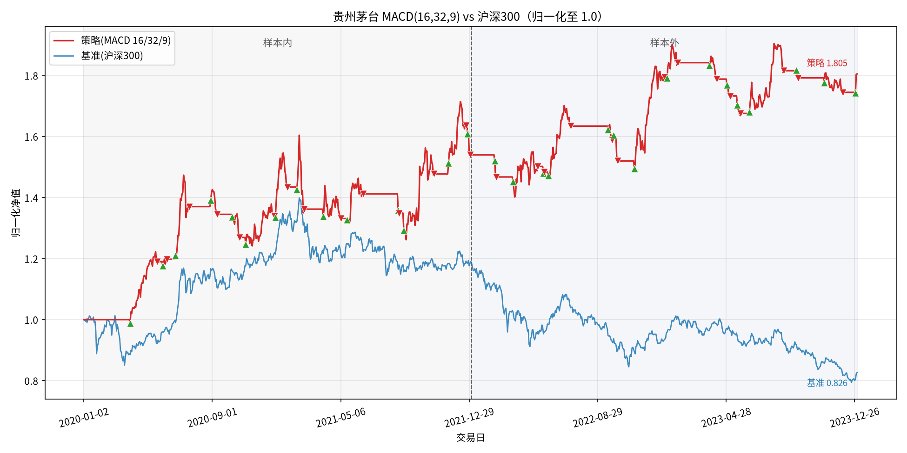

# 量化策略回测报告：MACD(16,32,9) vs 沪深300

## 1. 基准选择与理由

- **主基准：沪深300（sh000300）**
  - 标的贵州茅台是沪深300权重股，二者同属A股大盘蓝筹；用沪深300作为市场基准可分离「市场β」与「选股/择时α」。
  - 沪深300覆盖沪深两市300只大市值股票，是A股最常用的业绩比较基准，数据可长期稳定获取（akshare 新浪源）。
- **辅助参照：贵州茅台买入持有**
  - 与策略使用同一标的，用于把超额收益进一步分解为「选股」与「择时」。

## 2. 数据与回测设置

- 标的：贵州茅台（sh600519），前复权日线
- 区间：2020-01-02 ~ 2023-12-29，共 970 根 K 线
- 样本内：2020-01-01 ~ 2021-12-31；样本外：2022-01-01 ~ 2023-12-31
- 初始资金：1,000,000 元；单边佣金：0.030%
- 撮合规则：信号出现后下一根 bar 开盘价成交，避免未来函数

## 3. 绩效横向对比

四项必报指标：累计收益率、年化收益率、最大回撤、夏普比率。

### 3.1 全样本（970 个交易日）

| 指标 | 策略 | 沪深300 | 贵州茅台买入持有 |
|---|---:|---:|---:|
| 累计收益率 | +80.49% | -17.37% | +64.00% |
| 年化收益率 | +16.60% | -4.84% | +13.73% |
| 最大回撤 | -21.34% | -43.22% | -47.04% |
| 夏普比率 | 0.857 | -0.164 | 0.580 |

### 3.2 样本内（486 个交易日）

| 指标 | 策略 | 沪深300 | 贵州茅台买入持有 |
|---|---:|---:|---:|
| 累计收益率 | +53.99% | +18.98% | +85.26% |
| 年化收益率 | +25.15% | +9.45% | +37.77% |
| 最大回撤 | -21.34% | -18.19% | -39.92% |
| 夏普比率 | 1.058 | 0.539 | 1.128 |

### 3.3 样本外（484 个交易日）

| 指标 | 策略 | 沪深300 | 贵州茅台买入持有 |
|---|---:|---:|---:|
| 累计收益率 | +17.21% | -30.23% | -11.53% |
| 年化收益率 | +8.64% | -17.12% | -6.19% |
| 最大回撤 | -12.14% | -32.95% | -33.99% |
| 夏普比率 | 0.598 | -1.000 | -0.117 |

## 4. 超额收益及来源分解

| 区间 | 超额收益(策略−沪深300) | 选股贡献 | 择时贡献 | 持仓天数占比 |
|---|---:|---:|---:|---:|
| 全样本 | +97.86% | +81.36% | +16.49% | 46.4% |
| 样本内 | +35.01% | +66.28% | -31.27% | 49.2% |
| 样本外 | +47.44% | +18.70% | +28.74% | 43.6% |

**分解口径**：

- 选股贡献 = 贵州茅台买入持有 − 沪深300（同区间持有标的相对市场的超额）
- 择时贡献 = 策略 − 贵州茅台买入持有（空仓/进出场带来的超额）
- 超额收益 = 选股贡献 + 择时贡献 = 策略 − 沪深300

## 5. 交易与风险特征

- 全样本交易笔数：57 笔（样本内 28 笔，样本外 29 笔）
- 全样本持仓天数占比：46.4%
- 最大回撤：策略 -21.34%，沪深300 -43.22%

## 6. 归一化净值曲线

> 策略与基准均归一化至 1.0 起算；绿色▲为买入、红色▼为卖出；虚线左侧为样本内、右侧为样本外。

## 7. 结论与说明

- 全样本超额收益 +97.86%，其中选股贡献 +81.36%、择时贡献 +16.49%。
- 择时在样本内为 -31.27%（牛市满仓买入持有更强），样本外为 +28.74%（熊市空仓避险）；策略的主要价值体现在回撤控制：最大回撤 -21.34%，低于沪深300的 -43.22%。
- 选股贡献反映贵州茅台相对沪深300的事后强弱，不等于可持续的选股能力；样本外区间未重新调参，属于真正的样本外延续。
- 局限：单标的、单参数组合，未计滑点与冲击成本，结论不宜直接外推。
